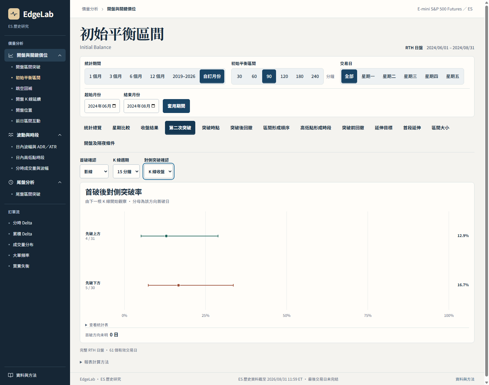
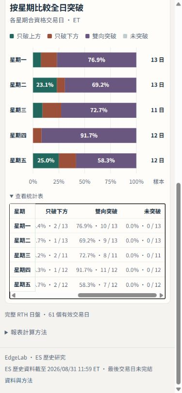

# EdgeLab

**E-mini S&P 500 Futures Research Portfolio**

EdgeLab 是一個互動歷史統計網站，展示 ES 日盤的開盤區間突破（ORB）、初始平衡區間（IB）、波幅、尾盤及訂單流。15 份報表包括分時 Delta、累積 Delta、成交量分布、大單頻率和買賣失衡。

## 在本機開啟

下載 [`index.html`](./index.html)，用 Chrome 或 Edge 開啟。HTML 已包含圖表、篩選功能及統計摘要，可離線使用。瀏覽器足以運行，毋須帳戶、API key 或另外下載行情。

如想用本機網址預覽，在只存放發佈檔案的資料夾執行以下指令，再開啟 `http://127.0.0.1:8000/`。此方法需要 Python 3。

```sh
python -m http.server 8000 --bind 127.0.0.1
```

## 報表預覽

### 開盤區間突破（ORB）


### 初始平衡區間（IB）



### 分時 Delta


### 手機版星期比較



## 資料範圍

- 可自選 2019 年 1 月至 2026 年 8 月的起訖月份。完整日盤統計截至 2026 年 8 月 28 日。歷史來源截至 8 月 31 日 11:59 ET，當日交易時段尚未完結。
- 使用歷史原始價格。報表列出各自的合資格樣本。成交量以合約數計，大單事件以筆數計。
- 報表顯示歷史事件發生率。網站沒有模擬成交、費用、滑點或資金曲線。計算口徑可在網站的「資料與方法」查閱。
