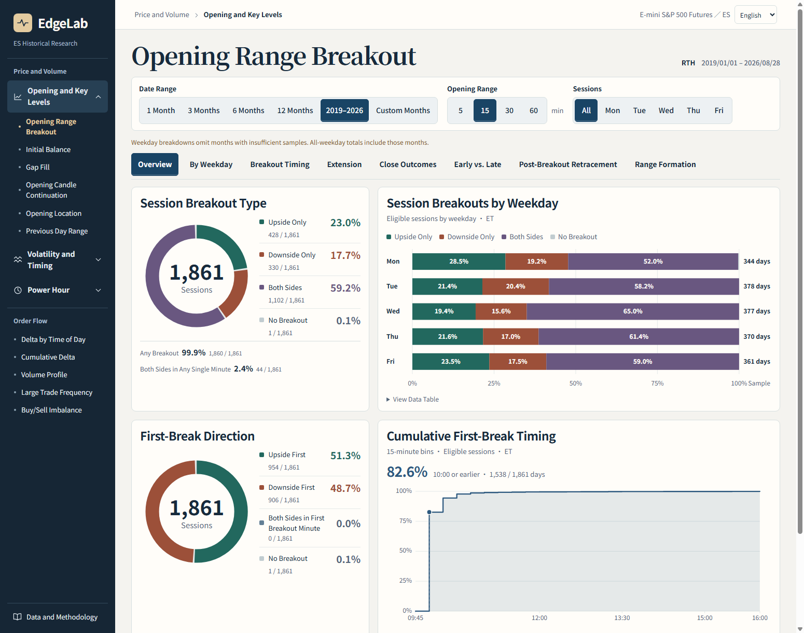

# EdgeLab

**E-mini S&P 500 Futures Research Portfolio**

EdgeLab is an interactive portfolio of 15 historical ES session reports covering opening ranges, initial balance, volatility, the final trading hour, and order flow. The order flow reports cover intraday Delta, cumulative Delta, volume profile, large trades, and buy/sell imbalance.

## Open locally

Download [`index.html`](./index.html) and open it in Chrome or Edge. The file includes the charts, filters, and statistical summaries for offline use. English is the default, with Traditional Chinese available in the language menu.

To preview it through a local web server, run the following command with Python 3 from the folder containing the published files, then open `http://127.0.0.1:8000/`.

```sh
python -m http.server 8000 --bind 127.0.0.1
```

## Report previews

### Opening Range Breakout (ORB)



### Initial Balance (IB)


### Delta by Time of Day


### Mobile weekday comparison


## Data coverage

- Select start and end months from January 2019 through August 2026. Complete-session statistics end on August 28, 2026. Source data ends on August 31 at 11:59 ET, during an incomplete session.
- Reports use unadjusted historical prices and show their eligible sample sizes. Volume is measured in contracts and large trade events are counted as events.
- Rates describe historical events. The reports do not simulate fills, fees, slippage, or equity curves. See the [statistical methodology](./METHODOLOGY.md) for definitions and denominators.
