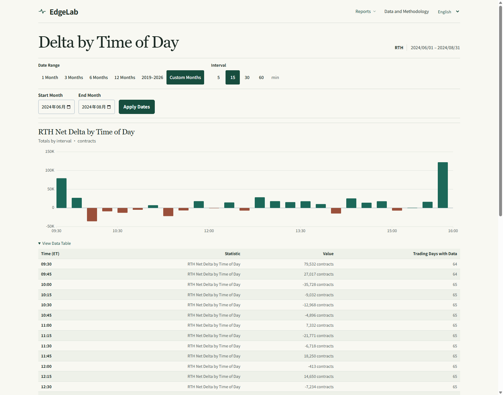

# Quantitative Future Research Dashboard

**EdgeLab · Historical ES session analysis for developing testable trading hypotheses**

EdgeLab is an interactive research dashboard for E-mini S&P 500 futures (ES). Its 15 reports examine regular-session price behavior, volatility, and order flow, from the opening range and Initial Balance to the final trading hour. Order flow studies cover intraday and cumulative Delta, volume profile, large trades, and buy/sell imbalance.

Select a month range, compare weekdays or report settings, and open the data table to see the counts behind each rate. Use those comparisons to define what a strategy should test, such as a breakout confirmation rule, a gap-fill target, or a time-of-day filter.

## Open locally

Download [`index.html`](./index.html) and open it in Chrome or Edge. The charts, filters, and statistical summaries are built into the file for offline use. English is the default, with Traditional Chinese available in the language menu.

To preview it through a local web server, run the following command with Python 3 from the folder containing the published files, then open `http://127.0.0.1:8000/`.

```sh
python -m http.server 8000 --bind 127.0.0.1
```

## Strategy research applications

| Research question | What EdgeLab measures | What to test in a backtest |
|---|---|---|
| Opening-range breakout continuation | Compare opening-range lengths, first-break timing, retracement, and where the session closes relative to the range. | How does acting on the first breach compare with waiting for a bar to close outside the range? |
| Initial Balance reversal | Compare how often price breaks the opposite side after its first break. Explore wick and bar-close confirmation rules. | When price closes back inside the range after the first break, how often does it subsequently reach the opposite boundary? |
| Opening gap fill | Compare how often price retraces part or all of the opening gap by the close, and when those levels are reached. | How do partial and full gap targets differ in reach rate and time to reach? |
| Time-of-day and order-flow filters | Compare intraday price range, contract volume, net Delta, and the share of sessions with positive Delta. | Does adding a time filter or requiring a completed interval's Delta to agree with the breakout direction change the outcome? Testing the Delta filter requires matching the breakout and Delta on the same sessions. |

### Worked example for opening-range breakouts

Open **Opening Range Breakout**, choose **By Weekday**, set the opening range to **15 minutes**, and select **June–August 2024**. The table shows that both sides of the opening range were broken on **10 of 13 Mondays (76.9%)** and **8 of 11 Wednesdays (72.7%)**. These counts describe the selected sample. Compare other periods before drawing a conclusion about weekday differences.

The full-session breakout outcome is known after the fact. To study a rule that could be applied during the session, compare a first-breach entry with an entry that waits for a bar to close outside the range. Use only information available at each decision. Keep exit rules comparable, account for fills and trading costs, and reserve a separate historical period for validation.

## Report previews

### Opening Range Breakout (ORB)


### Initial Balance (IB)


### Delta by Time of Day



### Mobile weekday comparison


## Data coverage

- Select start and end months from January 2019 through August 2026. Complete-session statistics end on August 28, 2026. Source data ends on August 31 at 11:59 ET, during an incomplete session.
- Reports use unadjusted historical prices and show their eligible sample sizes. Volume is measured in contracts and large trade events are counted as events.
- Rates describe historical events. Strategy performance requires a separate backtest of fills, fees, slippage, and net returns. See the [statistical methodology](./METHODOLOGY.md) for definitions and denominators.
